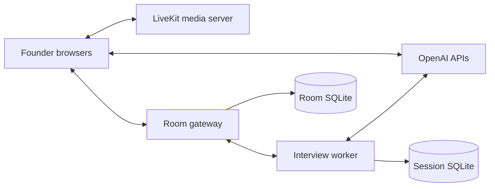

# Architecture and data

The gateway validates host/origin, room capabilities, admission and media credentials. The operator is loopback-only and owns interview state, estimated spending, agenda and scorecards. LiveKit routes participant media. The host browser handles the AI WebRTC connection and publishes the interviewer audio into the room; it must remain connected.

Applications and supplied context stay in process memory and are passed to OpenAI as needed. Browser drafts are opt-in local storage. Transcripts and scorecards persist in SQLite for up to 30 days and can contain application facts. Room capabilities expire after seven days. Derived business briefs and question banks (which may contain application facts) are cached for seven days and reused across rooms with the same application and notes; a persistent worker lookup avoids repeating paid research. Public research searches use an application-provided hostname without its path/query, or a fixed broad sector; private application text is not sent to web search. Interviewer research uses public sources and a time-limited cache. Raw audio/video is not recorded by this application; audio is transmitted to the media/AI services. Provider retention is governed by the account's provider agreement and settings.

The self-hosted setup sends no telemetry to Mostly Right. Optional analytics require the operator's own configuration and notices. Public web research can be incomplete or wrong: treat it as preparation context, not a verified identity or a prediction of a person's actual questions. Voices are stock synthetic practice voices.

The interviewer uses GPT-Live 1 for continuous audio conversation. Prepared questions are fallback material; follow-ups should respond to the founder's latest answer. The server sends silent time updates, reserves the final 30 seconds for closing, and ends the interview at ten minutes. Agenda checks run alongside the conversation; coaching belongs in the scorecard. These controls reduce scripted behavior but do not guarantee identical conversations or ChatGPT Voice parity.

People sharing one microphone share that participant's identity. Named captions use per-participant audio attribution and may lag; speaking indicators are instantaneous media activity and are not a transcript.
